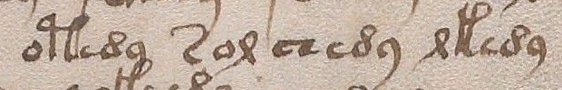
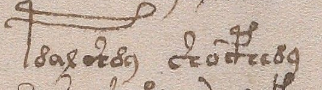
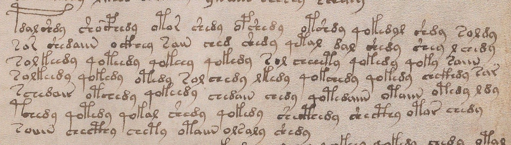

# GDT1348 — graphical resemblance retained; crossed component test unresolved

**TEMPLATE_CAPACITY_STOP__INFORMED_GRAPHIC_COMPATIBILITY.** A low bridge-like
motif is visually compatible with all three fixed embedded targets in one old
f83rparagraph. The preregistered stronger comparison could NOTbe completed:
the small free-k reference cuts its upper construction, and the expected free-t
reference is not fully present. No corrected alphabet, two-letter decomposition,
reading order or sound value follows.

This is one informed AIobservation of previously exposed images. Computational
validation checks provenance/accounting and retained limits, not whether the
visual interpretation is true. It is not three independent confirmations.

## The actual image question

1320and1333expanded cHh as either ch,H orH,ch for formal comparisons. They did
not establish that those are the actual linguistic units. Here the intended
crossed test required BOTHa low bench motif ANDa matching independently described
high-body motif, with a wrong-height comparator failing under the same restricted
overlap allowance. Simple resemblance alone was explicitly insufficient.

The first two images were fixed OLD996crops, reused without any pixel change:
T21for a free low bench and a free k-like body, T18for a free t-like body. Before
opening the paragraph, StageAwas frozen: low supports plus bridge were visible;
upper-k topology was clipped/incomplete; no reliable complete t exemplar was
included. Consequently a k-versus-t prototype discrimination was not available.

The larger paragraph crop was already the registered StageBview. It was viewed
once with the frozen deficiency retained. No new crop, resize, enhancement, OCR,
substitute target, image acquisition or inferred pen movement was introduced.

|Fixed locator in ZL|Low motif|Matching high template|Wrong-height comparison|Fixed crossed result|
|---|---|---|---|---|
|f83r.21G009 chckhdy|Locally compatible|Unresolved|Unresolved|Unscorable|
|f83r.23G006 shecthedy|Locally compatible|Unresolved|Unresolved|Unscorable|
|f83r.23G007 shecthy|Locally compatible|Unresolved|Unresolved|Unscorable|

Names above are source-guided locators, not phonemes, independently established
word identities or new authorial boundaries. All nine corresponding reader lines
(84groups) remain in SOURCE_PACKET.json; readers are not pooled. Approximate
image rectangles identify the inspected groups, not exact glyph segmentation.

## What the broader view suggests, and why it is not a repaired pass

The fixed targets show a low bridge-like construction extending to either side
of a taller construction. In the same paragraph view, the SAMEoriginal free
reference locations become visible more completely: the t-like upper form has
a more evident leftward upper loop/branch; the k-like form has a more upright
left upper stroke and a rightward loop. The embedded forms are qualitatively
compatible with these respective appearances.

Those fuller reference features were seen simultaneously with the target forms,
AFTERthe StageAfreeze. They are an exploratory comparison only. They cannot
retroactively supply the missing independent templates or promote the original
crossed test to PASS. The larger image is not unavailable; what is unavailable
is the planned complete pre-target prototype record from the two small crops.
This is a limitation of the chosen packet, not a physical contradiction of the
component hypothesis or a claim that no better images exist.

Even a complete graphic match would not choose among:

- one complex letter drawn from reusable visual parts;
- two letters joined into a ligature;
- one base drawing with a modifier.

It would not decide ch,H versusH,ch serialization. Nor does connected ink reveal
actual pen strokes or temporal stroke order. No graphical component is assigned
a source sound, syllable, grammar category or word meaning here.

## Source, chronology and scope

Source: already admitted f83r, Yale Beinecke MS408, original image1006224,
2753x3745, SHA256dc353557586906cbe4210f503cc57af58599a3948517fb45b1d222760be96729.
Original public URL and exact crop receipts are in IMAGE_RECEIPTS.json. Fullpage
admission is inherited from791/790;996already used these exact pixel crops.
Old996joined/split seam uncertainty and its semantic hypotheses are unchanged.
Those historical glosses were not reused. No new image admission or holdout.

|View|Original-image box x1,y1,x2,y2|Dimensions|
|---|---|---|
|StageA T21|870,1605,1490,1705|620x100|
|StageA T18|405,1370,940,1520|535x150|
|StageB paragraph|390,1360,2300,1905|1910x545|

Protocol/source hashes precede both StageAviews; the saved Aobservation and hash
precede the paragraph view and Bobservation. These are recorded chronology and
source receipts, not independent machine attestation of perception. The exact
three cropped images are retained byte-for-byte, with public Yale attribution.
They contain only the already admitted text area; no reserve or private material.

The initial accounting checker incorrectly assumed PNGmetadata was empty. The
old source crops retain the same standard3136byte sRGB ICCprofile. The correction
checks its exact key/hash without stripping metadata or altering pixels. It is
recorded in VALIDATOR_METADATA_CORRECTION.json; no observation or decision changed.

## Decision

Retain modest local graphic compatibility and the source-template capacity stop.
Do not infer a linguistic alphabet or reopen1307mandatory fusion,1311unresolved
run atomicity, or the1320/1333statistical decisions. This does not supply the
independently known units that made1347's pronunciation control successful.
No native sound/class assignment, general component identity or translation.

The source-free peer read the textual protocol, observations and chronology and
found the retained stop faithful; it did NOTview images or verify the motifs.
Programs verify hashes, dimensions, complete source selection, fixed targetIDs,
box bounds and decision accounting only. No relation packet, native meaning score,
f84/f84r/f116v/f1rbody, new source corpus or image-generation tool was used.
Reproduce with run/validate commands in experiment.json. No additional visual
search or new decoder is selected after this bounded outcome.

## Retained original views

