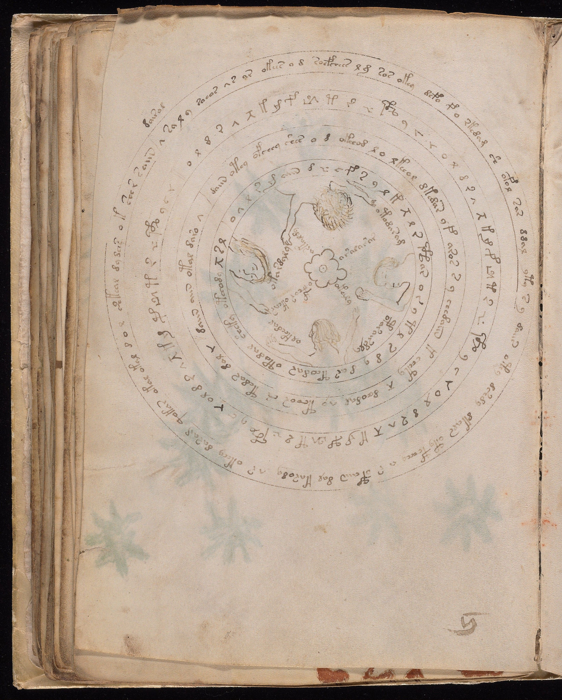

# GDT1352 — Spaced graphic forms, no independently fixed alphabet census

**SPACED_GRAPHIC_FORMS__AUTHORIAL_UNIT_BOUNDARIES_UNRESOLVED.** The complete second
text annulus on f57v clearly contains many spaced graphic forms, including tall
multi-stroke constructions. One original-resolution inspection does not establish
a uniform physical delimiter for every entry, exact repeated entry boundaries,
or an independent17-position census. No sound, alphabet size, new transcription
or modification of the old textual result follows.

The known fourfold17-position sequence is GDT184's prior result, not a discovery
of this test. Even17secure positions would not automatically mean17different
sign types, much less17phonemes. The old source counts remain unchanged; failure
to confirm their physical segmentation here is not a correction or refutation.

## What was observed directly

The target band is readily localized: the broad second annulus from outside,
with short spaced graphic forms, between the outer running-text band and the
next inner running-text band. Circumferential guide lines bound the band. They
do not form an individual cell around each apparent entry.

| Portion of the complete band | Informed visual observation |
|---|---|
| Upper arc | Spaced tall looped constructions and low/angular forms are clear; small detached marks complicate grouping by connected ink alone. |
| Right arc | Several tall multi-stroke constructions are separated by blanks; no uniform sequence of individual cells or clear repeated entry dividers observed. |
| Lower arc | Comparable spaced forms continue with circular orientation; no independently marked alphabet start identified. |
| Left arc | Spaced motifs continue; paler ink makes some fine grouping less secure. No replacement crop was opened. |

These four portions are coverage notes, not asserted authorial quarters or the
four repeat boundaries. Similar circles, angular shapes and tall looped forms
recur around the band, compatible with the known repetition. Distinct physical
start/end markers for all four repeats were not independently established.
No exact item/type count was filled from the prior17or from a transcription.

Many local shapes are visually separate. That qualified positive should not be
erased by the whole-band uncertainty. Conversely, a connected multi-part shape
could represent a complex character, a ligature, a syllable or another entry.
Nearby detached marks could belong with a shape or stand separately; this view
does not fix every case. No true pen sequence or linguistic atomicity is read
from static ink. No uniform delimiter observed means exactly that, not proof
that the author had no units or that a specialist could never resolve them.

## Why this was a different question

GDT1348tested resemblance of low/high motifs in compound drawings. Even its
successful graphic match would not determine the underlying unit count. Here
the candidate independent cue was an author-visible entry boundary pattern in
a repeated band. The pattern is not sufficiently fixed by this inspection to
supply an alphabet count. Repetition and spacious presentation remain visible;
the desired linguistic binding remains absent.

GDT184already demoted a four-element interpretation and explicitly withheld an
alphabet/key claim. GDT1169tested annulus-to-inner reading paths, finding none
explicitly bound. Neither old result is rerun or rescued. GDT1351's paired
control establishes representation dependence of a phonetic objective, not a
reason to assume that these ring entries are the true phonemes of running text.

## Admission, source and exposure

The previous [f57v grant](../../../docs/VOYNICH_DATA_SCOPE_20261004_F57V_LAYOUT.md)
was layout-only. Before acquiring/viewing pixels for this question, a separate
[image-only graphic scope](../../../docs/57v-signs.md) was registered under the
user's continuing research authorization and the same explicit admission
precedent used by1169/1126. The old grant was not rewritten. f57was not added to
the179textselectors; no raw transcript was accessed. A bounded scope search found
no explicit reserve for this image; it was not a complete global reserve audit.

The [official Yale image1006187](https://collections.library.yale.edu/iiif/2/1006187/full/full/0/default.jpg)
was reacquired at3028×3769. All2,470,040bytes match the old1169SHA256:
`2bf46dbeaaaab4a97075f46f503582da0eef2b352eb92277d7a3b6db1a3a0b8c`.
One full original-resolution view was used, with no crop, rotation, enhancement,
OCR, image generation or second canvas. Other bands, figures and margins were
incidental exposure and supplied no new transcription, interpretation or score.
f57r, f84/f84r, f116v, f1rbody and actual reserves remained closed.

Root was one informed AIobserver who knew the historical4×17claim. The image was
already exposed in prior work. This is not a new independent physical sample,
blind palaeography or independent reader agreement. The source-free peer checked
the planned scope without seeing pixels; that review is not a visual replicate
or an independently attested pre-view approval gate.

The original source is retained unchanged below. It has no EXIFtags and carries
the standard sRGB ICCprofile already encountered in prior source images, with
its exact hash recorded. No private image edits or local path metadata published.

## Validation and decision

The observation was frozen before the conclusion and accounting programs were
written. `run.py` summarizes that saved account; `validate.py` verifies source
identity, dimensions, metadata, recorded chronology, all four coverage notes,
null count fields and zero sound/meaning claims. **PASS_ACCOUNTING_ONLY** does
not validate visual truth or automatically establish authorial units. It also
does not prove the observer saw every fine stroke correctly.

Retain local spaced graphic constructions with unresolved complete entry
boundaries. Do not install a17-letter alphabet, a new parser or a native sound
key from this result. Do not reopen184's meanings or1169's paths. No automatic
extra image/zoom or repeated missing-input audit is selected.

Future phonetic hypotheses can still compare explicitly assumed segmentations
jointly with a writing rule; they need not wait for impossible certainty from
pictures alone. But those segmentations must remain assumptions and face fixed
whole-form predictions and existing counterexamples. This observation supplies
no preferred segmentation and does not authorize a large decoder repair.

