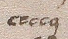
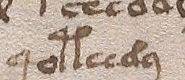
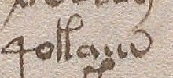
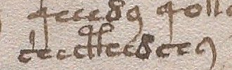
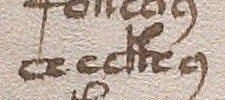

# GDT1402 — strict single-exemplar transfer fails; sign decomposition remains open

**The new image comparison does not establish the proposed crossed decomposition.**
The frozen high-A exemplar fails its strict transfer to TARGET_X; the other
high-template assignments remain unresolved. Both targets have a locally
compatible low bridge-like motif. This is a limited source-aware visual finding
on two different sites of one previously exposed page, not a linguistic alphabet.

The registered machine result is `FIXED_GRAPHIC_COMPOSITION_CONTRADICTED`.
Here that means **the particular frozen A features cannot be carried unchanged
into X under the fixed overlap rule**. It does not reject graphical composition
generally. A single free exemplar cannot define all ordinary handwriting variation;
a dark shallow cap versus an open elevated loop may distinguish instances rather
than underlying sign families. No wider tolerance or replacement exemplar was
introduced after seeing the result.

## What was different from the old stopped comparison

GDT1348 froze incomplete free high templates and retained three unscorable
embedded targets. That original decision and every source byte are unchanged.
The new source-guided selection fixed the first ckh and first cth locations on
f83r, outside the old target set, before opening pixels in this block. Complete
free examples on line2 were then delivered to a separate fresh-task observer.
It described their distinguishing visible features and saved StageA before it
received either anonymous target path. It was never given the expected class
mapping or transcript forms. Root localized the crops with source knowledge.

These controls limit expectation effects; they do not create virgin images,
independent manuscript replication or external attestation of mental exposure.
The observer could recognize familiar drawing families. Actual viewing order is
recorded by task and hash/time receipts, not externally certified by a clock.

## Frozen comparison, including the unresolved cases

| Drawing locator, ZL3b | Expected high | Low motif | Expected high | Other high | Fixed case |
|---|---|---|---|---|---|
| f83r.8 G003, shecthedchy, TARGET_X | A from f83r.2 G007 qoteedy | Compatible | Incompatible | Unresolved | Strict A-to-X transfer contradicted |
| f83r.5 G003, checkhy, TARGET_Y | B from f83r.2 G003 qokaiin | Compatible | Unresolved | Unresolved | Unscorable |

The free low reference is f83r.2 G002 cheey. These strings locate drawings;
they are not meanings, sounds, confirmed morphemes or assertions of atom count.
All81 original rows in the nine reader-lines remain in SOURCE_PACKET.json.
Readers are alternate transcriptions of one manuscript.

Frozen A has a shallow broad upper cap with a dark right extension; frozen B
has a visibly raised open right loop. X visibly has a raised right loop and
therefore conflicts with the chosen A description outside the permitted lower
junction. Its left upper detail does not establish every B feature. Y's full
upper attachment cannot be confidently isolated under either frozen description.
An unseen or ambiguous feature remains unresolved; it is not silently counted
as an incompatible one. See the independently authored STAGE_A.json and
STAGE_B.json for exact descriptions and limitations.

Even a crossed match would not choose between a complex single sign, a ligature
or a base plus modifier. This failure likewise does not prove the drawings are
atomic. No22-to18unit correction, ch-H/H-ch order, sound, language, word meaning
or native optional-fusion mechanism is selected. The1320positive comparison,
1333negative increment and1307mandatory-fusion failure keep their original scopes.

## Decision and verification

Retain the compatible lower motif and this failed strict template transfer.
Do not enlarge a shape library or start a decoder on its basis. A construction
hypothesis needs independently justified variation and a consequence for reading;
this two-example comparison supplies neither a native unit inventory nor one.
The scientific result is narrower than the machine status can sound in isolation.

The source is the already admitted Yale MS408 f83r image1006224, native2753x3745,
SHA256dc353557586906cbe4210f503cc57af58599a3948517fb45b1d222760be96729.
[Official image](https://collections.library.yale.edu/iiif/2/1006224/full/full/0/default.jpg).
The five PNG crops and localization strip preserve exact native pixel rectangles
and the original standard sRGB ICCprofile. No enhancement, OCR, redraw or inferred
stroke order was used. Original public image and guarded1342cache already exist
in the repository. Source/crop consistency can be replayed; perception cannot.

Independent validation checks source selection, fixed new-vs-old IDs, pixel and
metadata provenance, frozen bytes, recorded chronology and result accounting.
It does not certify actual localization, visual interpretation, blinding or
historical/linguistic identity. Source-free design and final scope reviews are
retained separately. f84/f84r remain sealed; no new page, source corpus, reserve,
f116v or f1rbody was opened. No semantic relation is accepted or scored.

Reproduction commands are in experiment.json. The isolated replay copies only
the fixed experiment and four old public inputs, then regenerates RESULT and
VALIDATION from the frozen observations. Byte equality is an accounting check,
not another visual observer or a rescued original1348test.

## Fixed images

| Low reference | High A | High B |
|---|---|---|
|  |  |  |

| Target X | Target Y |
|---|---|
|  |  |
