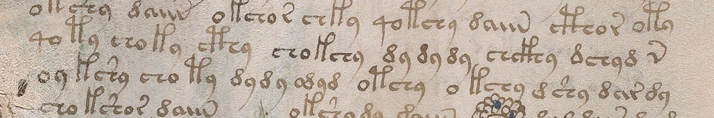

# GDT1432 — compact repeated-dy span in one original f14v view

**LOCAL_INTERNAL_CLEARANCE_SUPPORT.** In one informed original-image observation,
the two inner clearances of the three-repeat span at f14v.6 are tighter than
its immediate exterior clearances. At f14v.7 the double span has a tight inner
clearance and a broader left exterior clearance; its right exterior clearance
remains **UNRESOLVED**. This is a local graphic comparison, not a read word,
number, morpheme or source language.



## Exact recorded judgments

| Fixed clearance | Recorded category | Visible comparison |
|---|---|---|
|f14v.6 triple, left exterior|SPACE_LIKE|broader break from preceding group than either inner interval|
|f14v.6 first/second repeat|INTERNAL_LIKE|tighter than the two exterior separations; no continuous-ink claim|
|f14v.6 second/third repeat|INTERNAL_LIKE|same relatively compact rhythm compared with the neighboring groups|
|f14v.6 triple, right exterior|SPACE_LIKE|broader break before following chckhy than inside the repeat span|
|f14v.7 double, left exterior|SPACE_LIKE|wider separation after choty than between repeats|
|f14v.7 first/second repeat|INTERNAL_LIKE|relatively tight gap compared with the left exterior|
|f14v.7 double, right exterior|UNRESOLVED|modest gap to odyd; contrast not strong enough in this single view|

All seven reports and reasons remain in [OBSERVATION](artifacts/OBSERVATION.json).
No convenient subset, new crop or replacement was selected. The labels are
comparative AI judgments, not calibrated measurements. Nonzero whitespace can
occur inside a graphic group; an internal-like interval can still divide
linguistic words. The uncertain right comparator is retained rather than
silently resolved in favor of one transcription.

## What was actually learned

The existing literal span IT/RF `dydydy`, versus ZL `dy ~ dy ~ dy`, now has one
original-view basis for describing its three motifs as comparatively compact.
The photograph does not identify three phonetic syllables, three units of
quantity or one source word. The alternatives are readings of one manuscript,
not three independent confirmations. No claim is made that ZL's uncertain
small gaps are false or that IT/RF's linguistic segmentation is proved.

The double span on the next row is a fixed contrast, not an extra confirmation
chosen after viewing. Its right boundary remains unresolved. A source-aware
observer familiar with the transcriptions and question is not independent
palaeography. No semantic GDT388relation packet is scored.

IDEA1100's whole-field tally remains an unassigned raw possibility. Repeating
a graphic motif does not establish its numerical value or distinguish a tally
from another repetitive writing convention. Old1406retains its conditional
whole-group/code/wordbook obstruction;1416/1417and1429retain their respective
fixed-reading exclusions. None is reopened or repaired by this observation.

## Source, exposure and registration

The protocol and additive admission were public at commit
`8ef8203716faec253acb06318fdc7b03240b6823`, verified before first image access.
The [publication receipt](artifacts/REGISTRATION_PUBLICATION.json) records
13:59:07UTC. The first source request began13:59:24UTC.

Only Yale MS408canvas1006101,label14v,2812×3772 was fetched. Original response:
[original_f14v.jpg](artifacts/original_f14v.jpg), SHA256
`97dbdbe273597957d62db2cf3a6d9769a0121cba1d0bb682c8008a6d2de622a6`.
One unaltered overview located the two rows. Its whole-image content, including
plant and other writing, is incidental exposure and was not interpreted.
The source cache used only already-admitted IT rows6and7 with original indices;
it was not a new transcription census or a complete raw-row reconstruction.

The native rectangle **700,830,1800,300** was locked14:00:34.589676UTC, before
its request14:00:34.664829UTC and before its single original-detail display.
It contains the two complete middle rows and neighboring-row fragments.
Detail SHA256:
`21aedaeb2c390eab0d0893c88b831d0ceb64463495d81ffb806f39bc2b741f5f`.
Exact URLs, dimensions and response sizes are in the two SOURCE receipts;
[CROP_SCOPE](artifacts/CROP_SCOPE.json) preserves the prospective coordinates.
There was no OCR, enhancement, rotation, inferred pen movement, second
magnification, additional photograph or recrop. No reserve was opened.

[docs/14v.md](../../../docs/14v.md) prospectively corrects the old prepared
proposal's unnecessary fresh-approval demand. The governing rule required
registration before access; existing wind/f45r grants already used continuing
user authorization for narrow additional nonreserve keys. The earlier proposal
remains byte-frozen. The checked scope has no explicit f14v reserve designation;
that bounded check is not an exhaustive claim about historical exposure.
f84/f84r remain sealed; f116v and actual reserves stay closed.

## Checks and limits

The separate validator used saved source bytes, JPEG headers, hashes, source
identity, chronology, all seven categories and exact result transcription.
It did not view or decode pixels. [VALIDATION](artifacts/VALIDATION.json) is
**PASS_NOT_PERCEPTION**: correct source/record accounting, not independent
agreement with the visual judgment. The runner serializes the observation;
it does not infer boundaries or simulate another observer.

```bash
python3 experiments/yolo/gdt1432_f14v_dy_seam_comparison/src/run.py
python3 experiments/yolo/gdt1432_f14v_dy_seam_comparison/src/validate.py
```

These commands reproduce the saved records, not a fresh image judgment.
Original responses accompany the source receipts, so replay needs no network.
The acquisition helper refuses repeated source fetches when its files exist.

Decision: retain this qualified new local graphic observation and stop this
view sequence. No automatic tally decoder, global word-boundary revision,
extra zoom or source-word assignment. A later content hypothesis must carry
its own whole-context and word-profile obligations. Confirmed translated words0.
The inclusive13:40:26–14:25:26UTC budget includes preparation through publication;
the final publication receipt is recorded in the live active state.
