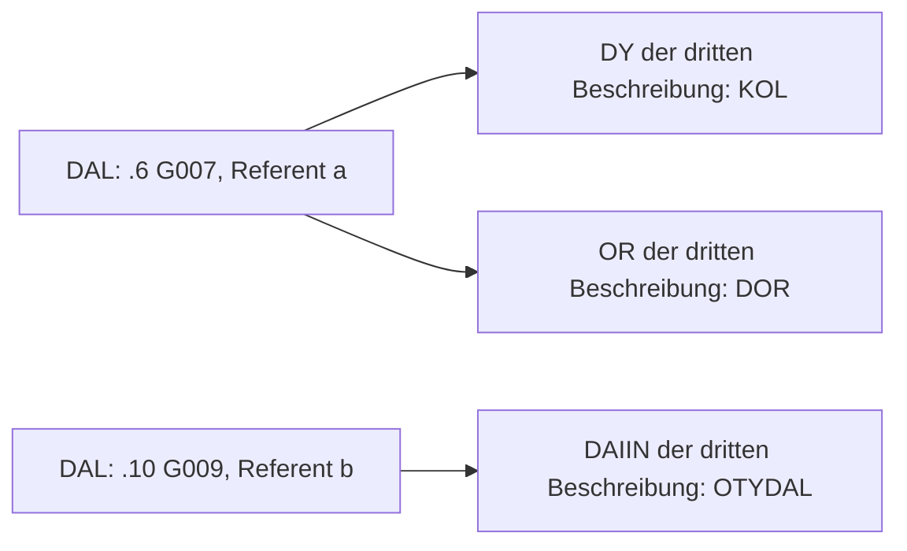

# f45r, Q2: eine neue Nennung verändert den folgenden Rückbezug

15. Oktober 2026. **Zusammenhängende Arbeitslesung mit unbekannten Bedeutungen.**
Q2 entwickelt dieselbe vollständige Seite weiter. Die wesentliche Änderung
betrifft eine tatsächlich geschriebene Reihenfolge:

```text
f45r.6:   … otar dal dary …
f45r.10:  … daldy dalor cheol dal
f45r.11:  l okaiin okcho laldan daldaiin
```

Die beiden gebundenen DAL-Formen in .10 stehen **vor** einer neuen alleinstehenden
DAL-Nennung. Das spätere DALDAIIN steht **danach**. Wenn eine Wiederaufnahme
jeweils die letzte passende gewöhnliche Nennung meint, wechseln hier die
geschriebenen Anker. Das ist eine nach Betrachtung dieser Folge entworfene
Hypothese, kein unabhängig vorhergesagter Befund und keine übersetzte Bedeutung.

## Die einfache Schreibregel

Der angenommene Schreiber könnte so vorgehen:

> Ich führe gewöhnliche Einträge der Reihe nach auf. Bei jeder neuen Nennung
> merke ich mir, welcher Eintrag dieses Namens zuletzt dran war. Eine entsprechend
> markierte Wiederaufnahme nimmt diesen zuletzt genannten Eintrag auf. Durch die
> Wiederaufnahme selbst wird kein neuer Eintrag eingeführt.

„Name“ bezeichnet hier lediglich dieselbe unbekannte Ganzwortbeschreibung,
keinen Eigennamen. Der formale Vertrag sucht nur exakte gewöhnliche Einträge:
kein Teilwort, keine ähnliche Schreibweise, keine nur erschlossene Eigenschaft.
Die Suche läuft über frühere Stellen dieser Seite, einschließlich des laufenden
Absatzes. Felder gehören weiterhin jeweils zu einem Absatz. Diese beiden
Reichweiten sind verschieden und werden ausdrücklich angenommen.

Der einmal gewählte Anker bleibt fest. Spätere gewöhnliche Nennungen hängen
frühere Verweise nicht um. Ohne vorherigen passenden Eintrag bleibt die Angabe
zunächst offen. Ein späterer ausdrücklicher Anker desselben Feldes kann dessen
gemeinsamen Wert bestimmen; das ist keine erneute Suche für frühere Wörter.

## Die gesamte Passage unter dieser Regel

Die folgende Gliederung enthält alle 61 gewöhnlichen Positionen und alle 15
Feldbeschreibungen. Mit den zehn freien Markern sind damit alle 86 IT2a-Gruppen
erfasst. Pfeile zeigen die angenommene Reihenfolge der gewöhnlichen Einträge,
keine Herstellung oder zeitliche Entwicklung. Die Quellenstellen der
unveränderten Feldgruppen stehen vollständig in der
[Q1-Ausrichtung](F45R_ORDERED_SPECIFICATION_20261015.md); das
[Quellenpaket](F45R_WHOLE_PAGE_SOURCE_20261015.json) erhält alle Rohgruppen und Leser.

**Absatz 1, f45r.1–4:**

```text
pykydal → shaikhy → oty → shey → qop → char → opchal → ypchar → ofchar
→ qoky → qokol → qokaiin → chol → chol → ykaiin → dar → om
→ qo → chcthy → chaiin → ykeey → cthom
→ lory → kaiin → ykeol → ykeol → cham
```

Das ist die erste geordnete Beschreibung. OPCHAL bezeichnet an Stelle 7 einen
später verfügbaren Referenten. Die beiden CHOL- und die beiden YKEOL-Stellen
bleiben erhalten. Der Absatz fordert zusätzlich einen CTHY-Feldwert mit den
unbekannten Beschreibungen SHOR und QOAIIN sowie einen DAIIN-Wert mit KCHOL.
Für keine dieser drei Feldbeschreibungen gibt es bei ihrem Auftreten schon
einen passenden gewöhnlichen Eintrag. Ihre Referenten bleiben offen.

**Absatz 2, f45r.5–7:**

```text
kolsho → pchor → kchey → ty → otshy → qokchy
→ otchar → ytchody → tcholol → otar → dal → dary
→ lchar → qor → y → kar → dar
```

Das geschriebene `opchaldy` zwischen TY und OTSHY greift über das DY-Feld auf
den OPCHAL-Eintrag aus dem ersten Absatz zurück. Die beiden DAIIN-Angaben
`doldaiin` und `okchar daiin` fordern gemeinsam DOL und OKCHAR, ohne einen
bereits gewöhnlich genannten Referenten zu finden. DOL ist nicht DAL.

Der alleinstehende DAL-Eintrag zwischen OTAR und DARY in **.6 G007** wird nun
zur letzten gewöhnlichen DAL-Nennung. Nennen wir seinen Referenten `a`. Er
übernimmt nicht die Beschreibungen sämtlicher anderen Einträge dieses Absatzes.

**Absatz 3, f45r.8–11:**

```text
m → chain → dain → ykolody → ytaiin → qotchol
→ okaiin → shar → yky → oky → kair → cheol → dal
→ l → okaiin → okcho → laldan
```

Die einleitenden Feldgruppen lauten `tchol cthy`, `qodaiin cthy`, `dain cthey`
und `otydal daiin`. CTHY verlangt TCHOL und QODAIIN von einem gemeinsamen
offenen Wert; CTHEY verlangt DAIN. Der DAIIN-Wert wird zunächst nur als
OTYDAL beschrieben. OTYDAL bleibt die ganze unbekannte Form.

Danach werden mit `dor or` und `kol dy` auch die OR- und DY-Werte zunächst
über DOR beziehungsweise KOL beschrieben. Bei `daldy` und `dalor` ist immer
noch der DAL-Eintrag **.6 G007** die letzte zulässige gewöhnliche Nennung.
Beide Formen nehmen deshalb `a` auf. Damit gelten KOL und DOR gemeinsam für `a`.

Erst nach diesen beiden Formen und CHEOL folgt der nächste gewöhnliche
DAL-Eintrag: **.10 G009**. Nennen wir dessen Referenten `b`. Diese geschriebene
Stelle wird zum neuen DAL-Anker. Das abschließende `daldaiin` in **.11 G005**
nimmt deshalb `b` auf. Nun gilt die frühere OTYDAL-Anforderung des DAIIN-Feldes
für `b`. Sie wird nicht zusätzlich auf `a` übertragen.

So lautet der verbundene Kern der ganzen Lesung:

> Die erste Beschreibung führt OPCHAL auf. Die zweite verwendet diesen Eintrag
> in ihrer DY-Beziehung und führt später DAL auf. Die dritte nimmt dieses DAL
> zunächst in zwei Beziehungen wieder auf. Danach nennt sie erneut DAL; die
> folgende DAIIN-Wiederaufnahme betrifft jetzt das zuletzt Genannte.

`a` und `b` haben verschiedene **geschriebene Anker**. Es wird ausdrücklich
nicht behauptet, dass sie verschiedene körperliche Gegenstände bezeichnen,
oder dass aus `a` ein Produkt `b` entsteht.

## Was gegenüber Q1 tatsächlich wechselt

Die Gruppierung, alle gewöhnlichen Positionen, die endlichen Zerlegungen und
die neun funktionalen Felder bleiben gleich. Nur ein Anker der vier tatsächlich
gebundenen Wiederaufnahmen ändert sich:

| Wiederaufnahme | Q1: einziger Treffer in früheren Absätzen | Q2: letzte frühere gewöhnliche Nennung |
|---|---|---|
| OPCHALDY, .5 G005 | OPCHAL .1 G007 | OPCHAL .1 G007 |
| DALDY, .10 G006 | DAL .6 G007 (`a`) | DAL .6 G007 (`a`) |
| DALOR, .10 G007 | DAL .6 G007 (`a`) | DAL .6 G007 (`a`) |
| DALDAIIN, .11 G005 | DAL .6 G007 (`a`) | DAL .10 G009 (`b`) |

Q1 verlangt `DAL(a), KOL(a), DOR(a), OTYDAL(a)` und außerdem `DAL(b)`.
Q2 verlangt `DAL(a), KOL(a), DOR(a)` sowie `DAL(b), OTYDAL(b)`.
Das sind unterschiedliche Bindungsbedingungen, keine neu ausgewählten Wortwerte.
Wenn `a` und `b` tatsächlich dasselbe bezeichnen, können die Bedingungen beider
Entwürfe zugleich gelten. Ein veränderter Anker allein beweist keinen anderen
Sachverhalt und keine richtige Interpretation.



**Ein bewusst erhaltener Nicht-Rückverweis:** Das gewöhnliche DAIN in .9 G004
steht nach `dain cthey` in .8. Es darf die frühere offene CTHEY-Angabe nicht
nachträglich auf sich ziehen. Kein späterer ausdrücklicher CTHEY-Anker löst
sie hier auf. Ebenso liefern `pykydal`, `laldan`, `kolsho` und `tcholol`
keine passenden Teilwort-Anker. Der neue Vertrag erzeugt keine weiteren
Rückverweise außer den vier tabellierten.

## Warum die Reihenfolge nun etwas bewirken kann

Verschöbe man DALDAIIN vor die zweite gewöhnliche DAL-Nennung, würde es nach
Q2 wieder `a` aufnehmen; entsprechend läge OTYDAL wieder auf `a`. Das ist
eine analytische Folge des verfassten Entwurfs, keine beobachtete Textvariante.
Schöbe man DALDY oder DALOR hinter die zweite Nennung, wechselte entsprechend
auch dessen Anker. Ein späteres Neuberechnen alter Anker ist dagegen verboten.

**Die genaue Schlussstellung bleibt unerklärt.** Jede Platzierung von DALDAIIN
nach der neuen Nennung und vor einer weiteren DAL-Nennung könnte denselben
Anker liefern. Auch ein bloßer Tausch von DALDY und DALOR vor der neuen Nennung
ändert hier keine Bindung. Q2 gibt der Überschreitung einer konkreten geschriebenen
Nennung eine Funktion; es liefert keine allgemeine Satzordnung oder Bedeutung
„Schluss“, „Ergebnis“ oder „danach“ für ein Wort.

## Kosten, Vorgänger und wissenschaftlicher Stand

Die neue Letzter-Treffer-Regel wurde bewusst **nach** Betrachtung dieser Folge
gewählt. Sie ersetzt Q1s Eindeutigkeitsbedingung und dessen Ausschluss laufender
Absätze. Mehrere frühere Treffer werden nun durch die Aktualitätsregel entschieden,
nicht durch neue Belege für ihre Identität. Die Annahmen gewöhnlicher
Beschreibungen, geordneter Inhalte, endlicher Markerzerlegungen und eines Wertes
pro Marker und Absatz bleiben stark. Die Leserabweichungen in den
vorherigen Darstellungen bleiben unbereinigt; die vollständige Ableitung ist IT2a.

Das Prinzip eines letzten passenden Referenten ist bereits untersucht worden:

- [GDT1039](../../../experiments/yolo/gdt1039_hour_day_reference_composition/REPORT.md)
  verwendet typisierte Abrufe, Verbrauch und Veröffentlichungszeit. Dort ändert
  auch ein erfolgreicher Abruf die Aktualität. Q2 übernimmt keine dieser
  zusätzlichen Regeln oder alten Wortwerte; nur gewöhnliche Schriftpositionen
  aktualisieren seine Suche.
- [W29 / IDEA226](../translation_programs_20260912/work/W29/REPORT.md) erhält
  verschiedene Vorgeschichten durch einen Bezug auf die nächste vorherige
  Materialnennung, konnte damit aber keine Referentenidentität auswählen.
  Seine Stoffglossen werden nicht übernommen. Mehr verträgliche Bindungen
  allein wären auch hier kein Bedeutungsgewinn.
- [GDT1137](../../../experiments/yolo/gdt1137_material_process_type_return/REPORT.md)
  ließ „letztes passendes Ergebnis“ neben seinem früheren-Rückbezug bestehen.
  Q2 behauptet weder solche produzierten Ergebnisse noch eine Vorgangskette.
- [GDT947](../../../experiments/yolo/gdt947_ol_content_reference_direction/REPORT.md)
  widerlegt eine feste Pflicht nackter Kerne im selben Absatz für seine Formen.
  Das wird durch die lokale Q2-Lesung nicht aufgehoben. GDT1047s Grenze einer
  universellen Postfixgrammatik bleibt ebenfalls bestehen.

R1 und Q1 bleiben unverändert dokumentiert. Die vollständige Q2-Konstruktion
gibt jetzt eine präzise mögliche Funktion für eine konkrete Reihenfolge an.
Die Bedeutung der Beziehungen und gewöhnlichen Inhalte, die gemeinten
Referenten und die tatsächliche Schreibabsicht sind weiterhin unbekannt.
Keine Reserve, keine neue Quelle, kein neuer statistischer Versuch und kein
bestätigtes Lexem folgen daraus.

## Nachvollziehbarkeit und nächste Entscheidung

[Vertrag und Arbeitsentscheidung](F45R_LATEST_MENTION_PROPOSAL_20261015.json),
[ausführbare Ableitung](F45R_LATEST_MENTION_BUILD_20261015.py) und
[vollständige Folge mit allen Bindungen](F45R_LATEST_MENTION_DERIVATION_20261015.json)
erhalten jeden ursprünglichen Platz. Q1 wird nur für die eingefrorene Gruppierung
und die Positionsdefinitionen verwendet; seine Identitäten werden neu aufgebaut.

```bash
python research_registry/proposals/production_origin_supply_20261003/F45R_LATEST_MENTION_BUILD_20261015.py
python research_registry/proposals/production_origin_supply_20261003/F45R_LATEST_MENTION_VALIDATE_20261015.py
```

Die [unabhängige Prüfung](F45R_LATEST_MENTION_ACCOUNTING_20261015.json) sucht für
jede Feldstelle separat in den davor geschriebenen gewöhnlichen Positionen;
sie übernimmt weder den Builder noch dessen mitgeführten Suchzustand. Sie
bestätigt die 86 Quellgruppen, alle 15 Feldereignisse, die vier Anker und den
einzigen Wechsel gegenüber Q1. Das bestätigt die Buchführung unter den
gewählten Regeln, keine Bedeutung oder historische Grammatik.

Für die weitere gemeinsame Inhaltslesung liegt jetzt eine klare Frage vor:
Gibt es einen sinnvollen Unterschied zwischen dem früher genannten DAL als
Träger von KOL/DOR und dem später genannten DAL als Träger von OTYDAL?
Das soll aus einer gemeinsamen Lesung mit den übrigen Angaben hervorgehen.
Solange dafür keine tragfähigen Wortwerte vorliegen, bleibt der Unterschied
eine Bindungshypothese. Weitere Umhängungen derselben unbekannten Variablen
wären keine Auswahl der richtigen Bedeutung.
