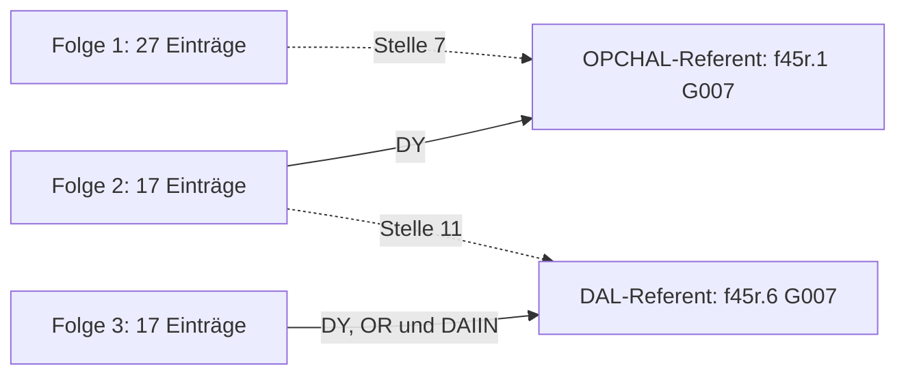

# f45r, Entwurf Q1: eine geordnete Beschreibung mit einzelnen Rückverweisen

15. Oktober 2026. **Alternative Arbeitslesung, alle Bedeutungen unzugewiesen.**
Q1 setzt die Synthese derselben ganzen Seite fort. Es wird kein neues Material
geöffnet und keine neue Versuchsserie begonnen. Die 86 IT2a-Gruppen bleiben
vollständig erhalten. Der [erste Entwurf R1](F45R_WHOLE_PASSAGE_RECONSTRUCTION_20261015.md)
bleibt unverändert als eigene, unbestätigte Lesart bestehen.

## Warum die erste Fassung noch nicht genügt

R1 behandelt die gewöhnlichen Angaben eines Absatzes als Eigenschaften eines
einzigen Referenten. Darum verändert das Weglassen eines zweiten `chol` oder
`ykeol` seine abschließenden Aussagen nicht. Auch das Vorziehen des letzten
`daldaiin` an den Anfang des dritten Absatzes würde unter R1 dieselben
abschließenden Feldbindungen ergeben. Seine tatsächliche Endstellung ist damit
erhalten, aber nicht erklärt. Die [analytische Prüfung](F45R_R1_CONSTRUCTION_LIMITS_20261015.json)
zeigt diese Grenze; sie widerlegt nicht jede beschreibende Lesart.

Q1 ändert zwei Annahmen gemeinsam: Gewöhnliche Vorkommen bilden **eine geordnete
Folge von Einträgen**, und ein Rückverweis übernimmt das an einer bestimmten
früheren Stelle Bezeichnete. Er übernimmt nicht sämtliche Beschreibungen des
früheren Absatzes. Die Bedeutung dieser Ordnung bleibt unbekannt: Es sind keine
Zutaten, Zeitphasen, Mengen oder Arbeitsgänge identifiziert.

## Die vollständige neue Arbeitslesung

Ein Wort wie `chol` steht unten weiterhin für dieselbe unbekannte Beschreibung.
Ein Pfeil bedeutet ausschließlich „nächster Eintrag in der beschriebenen Folge“.
Er bedeutet nicht „daraus entsteht“. Die Feldangaben stehen in der Quellenfolge
zwischen diesen Einträgen; ihre genauen Stellen sind weiter unten angegeben.

**Erster Absatz, f45r.1–4.** Der Schreiber beschreibt diese Folge von 27 Einträgen:

```text
pykydal → shaikhy → oty → shey → qop → char → opchal → ypchar → ofchar
→ qoky → qokol → qokaiin → chol → chol → ykaiin → dar → om
→ qo → chcthy → chaiin → ykeey → cthom
→ lory → kaiin → ykeol → ykeol → cham
```

OPCHAL steht an der siebten Stelle. Die beiden CHOL besetzen die Stellen 13
und 14; die beiden YKEOL die Stellen 25 und 26. Q1 erlaubt nicht, diese Paare
zu je einer Stelle zusammenzuziehen. Zusätzlich führt der Absatz zwei unbekannte
Beziehungen: Der CTHY-Wert muss SHOR und QOAIIN erfüllen; der DAIIN-Wert KCHOL.

**Zweiter Absatz, f45r.5–7.** Es folgt eine zweite Beschreibung mit 17 Einträgen:

```text
kolsho → pchor → kchey → ty → otshy → qokchy
→ otchar → ytchody → tcholol → otar → dal → dary
→ lchar → qor → y → kar → dar
```

Zwischen TY und OTSHY steht im Ausgangstext `opchaldy`. Im Entwurf heißt das:
„Für die DY-Beziehung dieser zweiten Beschreibung ist das gemeint, was im
ersten Absatz an der OPCHAL-Stelle bezeichnet wurde.“ Die weiteren Angaben
des ersten Absatzes werden dadurch nicht zu Eigenschaften dieses einzelnen
OPCHAL-Referenten. Das DAIIN-Feld des zweiten Absatzes verlangt DOL und OKCHAR
von einem noch unbestimmten Referenten. DOL bleibt ausdrücklich von DAL getrennt.

Der gewöhnliche DAL-Eintrag steht zwischen OTAR und DARY: elfte Stelle dieser
Folge, im Original **f45r.6, Gruppe 7**. Er wird als möglicher späterer Anker
aufbewahrt; die vorangehenden und folgenden Einträge bleiben eigenständig.

**Dritter Absatz, f45r.8–11.** Die dritte geordnete Beschreibung lautet:

```text
m → chain → dain → ykolody → ytaiin → qotchol
→ okaiin → shar → yky → oky → kair → cheol → dal
→ l → okaiin → okcho → laldan
```

Sie enthält 17 Einträge. OKAIIN steht an Stelle 7 und 15. Das sind zwei
getrennte Stellen, keine unmittelbar geschriebene Doppelung. Auch der DAL-Eintrag
an Stelle 13 ist eine eigene Position. Das behauptet noch keinen anderen
Gegenstand als bei früherem DAL.

Die Feldangaben dieses Absatzes beginnen schon vor seinem ersten gewöhnlichen
Eintrag M. CTHY verlangt TCHOL und QODAIIN; CTHEY verlangt DAIN. DAIIN, OR und
DY verlangen zunächst OTYDAL, DOR und KOL. Die späteren Formen `daldy`, `dalor`
und `daldaiin` nehmen unter der festgelegten Suchregel den einzelnen früheren
DAL-Eintrag in **f45r.6, Gruppe 7** wieder auf. Deshalb muss dessen Referent
gemeinsam **DAL, KOL, DOR und OTYDAL** erfüllen. Alle vier Bedeutungen sind
unbekannt; OTYDAL bleibt eine unzerlegte Ganzform.

Das ist die Verbindung über die ganze Seite: Die zweite Beschreibung verwendet
das an der OPCHAL-Stelle der ersten Bezeichnete. Die dritte verwendet das an
der DAL-Stelle der zweiten Bezeichnete. Die Verweise gelten nicht jeweils der
gesamten früheren Beschreibung.



## Sämtliche Feldangaben, an ihren wirklichen Stellen

Die 61 gewöhnlichen Einträge, 15 Feldbeschreibungen und zehn freien Marker
verwenden zusammen alle 86 Rohgruppen. Eine gebundene Feldform bleibt dabei
eine Rohgruppe. Die unveränderte vollständige
Transkription mit allen drei Lesern steht im
[vorhandenen Quellenpaket](F45R_WHOLE_PAGE_SOURCE_20261015.json).

| Absatz | Originalstelle in IT2a | Unbekannte Feldangabe | Gemeinsamer Wert unter Q1 |
|---|---|---|---|
| 1 | .2 G001–002: `shor cthy` | SHOR im CTHY-Feld | derselbe offene CTHY-Wert wie QOAIIN |
| 1 | .3 G003–004: `kchol daiin` | KCHOL im DAIIN-Feld | offen |
| 1 | .3 G005–006: `qoaiin cthy` | QOAIIN im CTHY-Feld | derselbe offene CTHY-Wert wie SHOR |
| 2 | .5 G005: `opchaldy` | OPCHAL im DY-Feld | Referent von .1 G007 |
| 2 | .5 G008: `doldaiin` | DOL im DAIIN-Feld | derselbe offene DAIIN-Wert wie OKCHAR |
| 2 | .6 G002–003: `okchar daiin` | OKCHAR im DAIIN-Feld | derselbe offene DAIIN-Wert wie DOL |
| 3 | .8 G001–002: `tchol cthy` | TCHOL im CTHY-Feld | derselbe offene CTHY-Wert wie QODAIIN |
| 3 | .8 G003–004: `qodaiin cthy` | QODAIIN im CTHY-Feld | derselbe offene CTHY-Wert wie TCHOL |
| 3 | .8 G005–006: `dain cthey` | DAIN im CTHEY-Feld | offen |
| 3 | .8 G007–008: `otydal daiin` | OTYDAL im DAIIN-Feld | durch .11 G005 an .6 G007 gebunden |
| 3 | .9 G001–002: `dor or` | DOR im OR-Feld | durch .10 G007 an .6 G007 gebunden |
| 3 | .9 G008–009: `kol dy` | KOL im DY-Feld | durch .10 G006 an .6 G007 gebunden |
| 3 | .10 G006: `daldy` | DAL im DY-Feld | Referent von .6 G007 |
| 3 | .10 G007: `dalor` | DAL im OR-Feld | Referent von .6 G007 |
| 3 | .11 G005: `daldaiin` | DAL im DAIIN-Feld | Referent von .6 G007 |

## Die Regeln und ihr Preis

Der [Q1-Vertrag](F45R_ORDERED_SPECIFICATION_PROPOSAL_20261015.json) übernimmt
R1s bereits festgelegte Gruppierung: fünf freie Marker und fünf endliche
gebundene Formen. Keine weitere Form wird zerlegt. Gewöhnliche Vorkommen
werden zu eigenen geordneten Einträgen. Eine unmittelbar folgende Markerfolge
nimmt ihren Beschreibungsträger ausschließlich als Feldargument, nicht zusätzlich
als gewöhnlichen Eintrag.

Jeder Eintrag hat eine **Position** und einen **Referenten**. Die Positionen
sind verschieden; die Referenten müssen nicht körperlich verschieden sein.
Dieselbe unbekannte Ganzwortbeschreibung gilt für gewöhnliche Einträge und
Feldargumente. Ein Referent kann mehrere Beschreibungen erfüllen. Keine davon
wird in eine konkrete Sachbedeutung übersetzt.

Alle Vorkommen eines Markers innerhalb eines Absatzes betreffen weiterhin
denselben Feldwert. Diese starke R1-Annahme wird beibehalten. Die Referenzsuche
ändert sich dagegen: Genau **ein früheres gewöhnliches Vorkommen** in einem
abgeschlossenen Absatz ist erforderlich. Zwei passende Einträge im selben
früheren Absatz wären mehrdeutig; die alte R1-Regel „ein passender Absatz“ würde
nicht genügen. Keine Auswahl des nächsten oder letzten Treffers, keine Suche
im laufenden Absatz und keine Suche in Teilzeichenketten oder erst erschlossenen
Eigenschaften. Auf dieser Seite entstehen vier eindeutige Bindungen an zwei
solche früheren Vorkommen.

Die unbekannte Ordnung ist eine zusätzliche Inhaltsannahme. Dass ein Programm
die Schriftpositionen erhält, beweist keine im Manuskript gemeinte Ordnung.
Q1 behauptet ausdrücklich mehr: Zwei gleich beschriebene Positionen gehören
zum beschriebenen Aufbau. Es ist noch nicht bekannt, *welcher* Aufbau das wäre.

## Was dadurch gelöst wird und was nicht

Unter Q1 verändert das Streichen eines CHOL- oder YKEOL-Eintrags die beschriebene
Folge. Das Vertauschen unterschiedlich beschriebener Einträge verändert die
spezifizierte Folge; gleich beschriebene Stellen sind dadurch noch nicht
individuell unterschieden.
Die getrennten OKAIIN-Stellen fallen unter dieselbe Regel; es braucht keine
besondere „Doppelwort bedeutet doppelte Dosis“-Ausnahme.

**Die Reihenfolge der Feldbehauptungen ist damit noch nicht erklärt.** Ein
Vorziehen von DALDAIIN oder ein Vertauschen von DALDY und DALOR kann weiterhin
dieselben endgültigen Feldwerte liefern. Die letzte Form erhält daher auch
in Q1 keine belegte Schluss-, Ergebnis- oder Abschlussfunktion. Der Entwurf
ist in diesem Punkt bewusst unvollständig.

Die Aussagen aus R1 und Q1 dürfen nicht vermischt werden. Insbesondere gelten
KOL, DOR und OTYDAL in Q1 für den einzelnen früheren DAL-Referenten, nicht für
einen gemeinsamen Träger aller 17 gewöhnlichen Angaben von Absatz 2. R1 ist
nicht empirisch widerlegt, und Q1 ist nicht durch bessere Passgenauigkeit an
unbekannte Bedeutungen bestätigt.

## Bekannte Grenzen und Vorgänger

Die vorhandenen Wortprofile wurden vor Auswahl erneut herangezogen. CHOL zählt
ZL/IT/RF 338/345/314 exakte Vorkommen, darunter 21/19/19 unmittelbare Doppelungen;
YKEOL 11/9/10, mit je einer Doppelung auf f45r; OKAIIN 200/198/187, mit 6/6/5
unmittelbaren Doppelungen andernorts. Die f45r-Doppelungen CHOL und YKEOL sowie
die getrennten OKAIIN-Vorkommen sind bei allen drei Lesern vorhanden. Keine
dieser Zahlen wählt Menge, Wiederaufnahme, Handlung oder Wortart aus.

[GDT809](../../../experiments/yolo/gdt809_record_conditioned_whole_head_semantic_tournament/REPORT.md)
und [GDT815](../../../experiments/yolo/gdt815_referent_property_discrimination/REPORT.md)
ließen Wiederholung, Eigenschaft und Referenz bereits offen. Ihre historischen
Glossen werden nicht als Wortwissen verwendet. Das Muster allein darf weiterhin
weder zu einer zusätzlichen Handlung noch zu derselben Zubereitung umgedeutet werden.

Die Idee bedeutungstragender Wiederholung ist nicht neu:
[IDEA965s Mengenvertrag](MEASURED_MATERIAL965_COST_OBLIGATION_20261006.json)
fordert gemessene Beiträge; Q1 übernimmt weder seine Einheiten noch seine
Kontrollwörter. [GDT1360](../../../experiments/yolo/gdt1360_typed_roster_repeat_obstruction/REPORT.md)
erhält getrennte geordnete Phasen im Vergleichsmodell, ohne damit Zeit im Voynich
zu belegen. Q1 übernimmt keine Zeitannahme.
[GDT1145](../../../experiments/yolo/gdt1145_ordered_membership_whole_reading/REPORT.md)
blieb als vollständige Mitgliedschaftslesung unvollständig; seine Operationen
und ordinalen Werte werden nicht übernommen. Die gescheiterten festen Rezept-
und Produzentenbindungen aus GDT1146/1147 bleiben ebenso bestehen. Eine
allgemeine Neuheitsbehauptung wird nicht erhoben.

Der Entwurf gilt weiterhin nur für die gewählte IT-Seite. Die in R1 dokumentierten
ZL/RF-Abweichungen, vor allem bei CTHY/CTHEY, DOR/OR und OTYDAL, bleiben bestehen.
RF liefert hier keine eigenen Absatzflags. GDT1047s paragrapheninitiales DAIIN
bleibt ein Gegenfall gegen die universelle Übertragung der Postfixregel.

## Reproduktion und Arbeitsentscheidung

Die [Ableitung](F45R_ORDERED_SPECIFICATION_BUILD_20261015.py) übernimmt nur die
hashgebundene R1-Gruppierung. Sie verwirft deren Absatzreferenten und erzeugt
61 eigene Positionen, neun Felder und die vier neuen Vorkommensbindungen.
Das [Ergebnis](F45R_ORDERED_SPECIFICATION_DERIVATION_20261015.json) enthält alle
86 Quellpositionen, Beschreibungen, Referenten und Bindungen.

```bash
python research_registry/proposals/production_origin_supply_20261003/F45R_ORDERED_SPECIFICATION_BUILD_20261015.py
python research_registry/proposals/production_origin_supply_20261003/F45R_ORDERED_SPECIFICATION_VALIDATE_20261015.py
```

Die [unabhängige Buchführungsprüfung](F45R_ORDERED_SPECIFICATION_ACCOUNTING_20261015.json)
rekonstruiert Positionen und Referenten aus Quelle und festgelegter Gruppierung,
ohne den Builder oder R1s Identitäten zu übernehmen. Sie bestätigt die vollständige
Zuordnung und die vier exakten Anker; sie bestätigt keine Bedeutungen oder
historische Funktion der angenommenen Ordnung.

Die Entscheidung lautet: Q1 als konkrete alternative **Gesamtlesung** erhalten.
Der nächste Inhaltsentwurf muss erklären, was die geordnete Folge und ihre
gemeinsamen Feldwerte bedeuten könnten, und die verbleibende Feldreihenfolge
offen behandeln. Eine beliebige Menge neuer Tätigkeitswörter würde diese
Aufgabe umgehen. Konkrete Wortwerte bleiben an bestehende Profile und
Primärevidenz gebunden; Reserven bleiben geschlossen.
