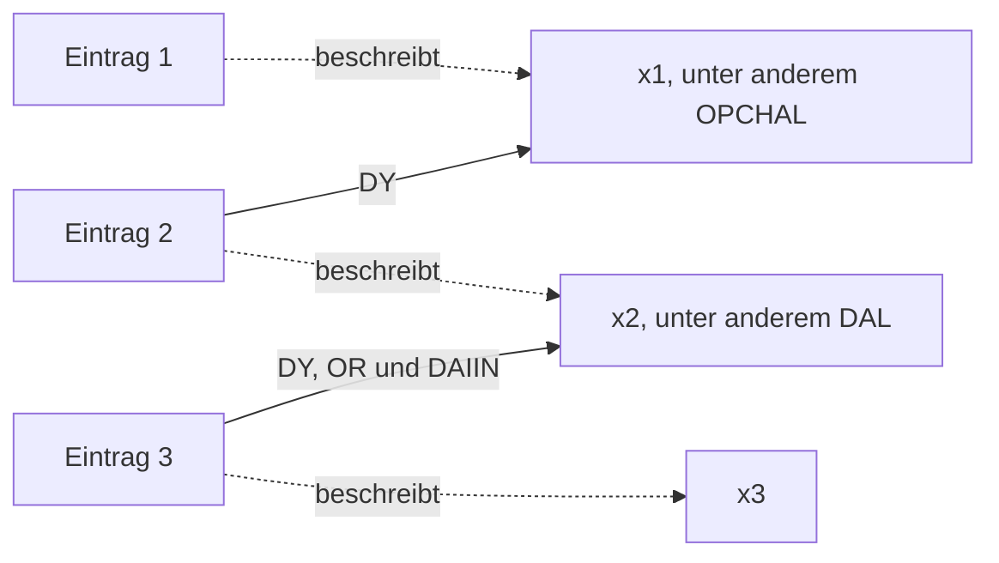

# f45r: eine zusammenhängende Rekonstruktion mit unbekannten Bedeutungen

Stand: 15. Oktober 2026. **Explorativer Entwurf R1, keine Übersetzung.**
Die gesamte Seite wird nach einer einzigen Regelgruppe gelesen: 86 IT2a-Wortgruppen,
elf Zeilen, drei vollständige Absätze mit 33, 21 und 32 Gruppen. Die Bedeutungen
bleiben unbesetzt. Der Entwurf macht sichtbar, welche unbekannten Inhalte zusammen
passen müssten, wenn diese Konstruktion richtig ist.

## Die Passage in verständlichen Worten

Wir nehmen versuchsweise an, der Schreiber lege pro Absatz einen Eintrag an.
Jeder Eintrag beschreibt etwas und enthält bestimmte Beziehungsfelder.
`CTHY`, `CTHEY`, `DAIIN`, `DY` und `OR` sind hier lediglich Namen dieser Felder.
Sie bedeuten ausdrücklich noch nicht „Teil“, „Menge“, „Zustand“ oder Ähnliches.
`x1`, `x2` und `x3` bezeichnen das jeweils Beschriebene; unterschiedliche Namen
behaupten noch keine unterschiedlichen Gegenstände in der Welt.

**Erster Absatz:** Beschrieben wird `x1`. Dazu gehören die unbekannten Angaben
`pykydal, shaikhy, oty, shey, qop, char, opchal, ypchar, ofchar; qoky, qokol,
qokaiin, chol, chol, ykaiin, dar, om; qo, chcthy, chaiin, ykeey, cthom; lory,
kaiin, ykeol, ykeol, cham`. Der Eintrag nennt außerdem etwas im Feld CTHY,
das sowohl die Beschreibung `shor` als auch `qoaiin` erfüllt. Im Feld DAIIN
steht etwas mit der Beschreibung `kchol`.

**Zweiter Absatz:** Jetzt wird `x2` beschrieben: `kolsho, pchor, kchey, ty,
otshy, qokchy; otchar, ytchody, tcholol, otar, dal, dary; lchar, qor, y, kar,
dar`. Das zusammengesetzte `opchaldy` lesen wir als OPCHAL im Feld DY.
OPCHAL kam bereits als Beschreibung von `x1` vor. Mit der unten ausdrücklich
angenommenen Rückverweisregel lautet dieser Teil daher: **„Im DY-Feld dieses
zweiten Eintrags steht das zuvor als OPCHAL beschriebene `x1`.“** Im DAIIN-Feld
des zweiten Eintrags steht etwas, auf das sowohl `dol` als auch `okchar` zutrifft.
`dol` bleibt von `dal` verschieden.

**Dritter Absatz:** Beschrieben wird `x3`: `m; chain, dain, ykolody, ytaiin,
qotchol; okaiin, shar, yky, oky, kair, cheol, dal; l, okaiin, okcho, laldan`.
Im CTHY-Feld steht etwas, das sowohl `tchol` als auch `qodaiin` erfüllt. Im
CTHEY-Feld steht etwas mit der Beschreibung `dain`. Drei weitere Angaben
werden zunächst offen eingeführt: `otydal` im DAIIN-Feld, `dor` im OR-Feld
und `kol` im DY-Feld. Die späteren Formen `daldy`, `dalor` und schließlich
`daldaiin` nehmen jeweils das schon im zweiten Absatz als DAL beschriebene
`x2` auf. Unter dieser Lesart sagen die drei Felder gemeinsam:
**„Hier ist in allen drei Beziehungen `x2` gemeint; auf dieses `x2` müssen
zusätzlich KOL, DOR und die ganze Beschreibung OTYDAL zutreffen.“**

Damit entsteht eine zusammenhängende Folge: Der zweite Eintrag nimmt das im
ersten Beschriebene auf; der dritte nimmt das im zweiten Beschriebene auf.
Die zusätzlichen Beschreibungen können nicht mehr unabhängig für jede Stelle
erfunden werden. Sie müssen mit dem jeweils wieder aufgenommenen Inhalt vereinbar
sein. Es ist noch offen, ob solche Einträge tatsächlich dem Text entsprechen.



Die Feldpfeile zeigen auf das im früheren Absatz Beschriebene. Ein Beziehungsfeld gehört
zum **Eintrag**, nicht unmittelbar zum Gegenstand. Selbst wenn zwei Absätze
später denselben Gegenstand beschreiben sollten, verschmelzen dadurch nicht
automatisch ihre Felder. Das Diagramm behauptet weder einen Herstellungsvorgang
noch eine zeitliche Abfolge.

## Der vollständige Ausgangstext

IT2a, unveränderte Wortgruppen. Zeilenumbrüche sind überliefert; Leerzeilen
markieren die Absatzgrenzen dieser Lesung. Die vollständigen Rohdaten einschließlich
Metadaten und alternativer Leser stehen im [Quellenpaket](F45R_WHOLE_PAGE_SOURCE_20261015.json).

```text
f45r.1   pykydal shaikhy oty shey qop char opchal ypchar ofchar
f45r.2   shor cthy qoky qokol qokaiin chol chol ykaiin dar om
f45r.3   qo chcthy kchol daiin qoaiin cthy chaiin ykeey cthom
f45r.4   lory kaiin ykeol ykeol cham

f45r.5   kolsho pchor kchey ty opchaldy otshy qokchy doldaiin
f45r.6   otchar okchar daiin ytchody tcholol otar dal dary
f45r.7   lchar qor y kar dar

f45r.8   tchol cthy qodaiin cthy dain cthey otydal daiin m
f45r.9   dor or chain dain ykolody ytaiin qotchol kol dy
f45r.10  okaiin shar yky oky kair daldy dalor cheol dal
f45r.11  l okaiin okcho laldan daldaiin
```

## Eine feste Konstruktion für alle drei Absätze

1. Jeder Absatz eröffnet einen Eintrag mit einem beschriebenen Referenten.
   Eine gewöhnliche, unzerlegte Wortform trägt eine unbekannte Beschreibung
   bei. Dieselbe Form hat im gesamten Entwurf dieselbe Beschreibung.
2. Folgt unmittelbar ein freies Feldzeichen, bezieht sich die Beschreibung
   ausschließlich auf dessen Argument. `shor cthy` beschreibt also den Wert
   des CTHY-Feldes, nicht gleichzeitig den Hauptgegenstand des Absatzes.
   Aufeinanderfolgende Feldzeichen würden dasselbe Argument teilen.
3. Nur fünf zusammengesetzte Formen sind zusätzlich zugelassen:
   `opchal+dy`, `dal+dy`, `dal+or`, `dal+daiin`, `dol+daiin`.
   Ihre Funktion entspricht Beschreibung plus Feldzeichen. Das ist eine
   endliche Annahme, keine allgemeine Zerlegung nach ähnlichen Endungen.
4. Alle Vorkommen desselben Feldzeichens innerhalb eines Absatzes betreffen
   denselben Feldwert. Ein Zeilenende setzt ihn nicht zurück; der nächste
   Absatz beginnt einen neuen Eintrag. Mehrere Beschreibungen sammeln sich
   daher am selben Wert.
5. Eine Feldbeschreibung sucht ihren Referenten ausschließlich unter den
   ausdrücklich geschriebenen gewöhnlichen Beschreibungen früherer,
   abgeschlossener Absätze dieser Seite. Gibt es genau einen passenden
   Absatz, wird dessen Referent aufgenommen. Ohne Treffer bleibt der Wert
   offen; mehrere passende Absätze wären eine ungelöste Mehrdeutigkeit.
   Aktueller Absatz, Teilzeichenketten und erst abgeleitete Eigenschaften
   sind keine zulässigen Trefferquellen.

Die fünfte Regel ist die entscheidende **neue Rückverweisannahme**. Eine
wiederholte Klassenbezeichnung könnte ebenso gut ein neues Exemplar derselben
Klasse einführen. Die Schriftform allein entscheidet das nicht.

`otydal`, `pykydal`, `qodaiin`, `ykolody`, `ytchody`, `dor`, `laldan`, `m` und
`l` bleiben ganze, unübersetzte Beschreibungen. Insbesondere wird OTYDAL
nicht zu OTY+DAL zerlegt. Seine Verbindung zu DAL entsteht hier ausschließlich
durch das gemeinsame DAIIN-Feld im dritten Absatz. Der dort allein stehende
`dal` beschreibt `x3`; er ist nach Regel 5 kein zulässiger früherer Referent.

## Die neun Felder und ihre gemeinsamen Anforderungen

Die Tabelle fasst zusammen, was im Text teilweise erst später gebunden wird.
Sie behauptet keine unmittelbare Sicherheit beim ersten Auftreten.

| Eintrag | Feld | Geschriebene Belege | Gemeinsame Bedingung im Entwurf |
|---|---|---|---|
| 1 | CTHY | `shor cthy`; `qoaiin cthy` | Ein offener Wert erfüllt SHOR und QOAIIN. |
| 1 | DAIIN | `kchol daiin` | Ein offener Wert erfüllt KCHOL. |
| 2 | DY | `opchaldy` | `x1`, zuvor als OPCHAL beschrieben. |
| 2 | DAIIN | `doldaiin`; `okchar daiin` | Ein offener Wert erfüllt DOL und OKCHAR. |
| 3 | CTHY | `tchol cthy`; `qodaiin cthy` | Ein offener Wert erfüllt TCHOL und QODAIIN. |
| 3 | CTHEY | `dain cthey` | Ein offener Wert erfüllt DAIN. |
| 3 | DAIIN | `otydal daiin`; `daldaiin` | `x2` erfüllt OTYDAL und DAL. |
| 3 | OR | `dor or`; `dalor` | `x2` erfüllt DOR und DAL. |
| 3 | DY | `kol dy`; `daldy` | `x2` erfüllt KOL und DAL. |

Es gibt vier ausgeschriebene Rückverweisvorkommen, die zwei Verbindungen
zwischen Absätzen herstellen. Nicht verankerte Werte sind weder zwangsläufig
verschieden noch ohne Beleg gleichgesetzt. DAIN beschreibt hier einmal einen
CTHEY-Wert und einmal `x3`; daraus folgt keine Identität dieser Referenten.

## Was aus früherer Arbeit stammt, was wir hinzufügen

Übernommen werden die Unterscheidung von ganzen Formen und gerichteten Teilen,
die endliche DAL-Familie, der Vergleich freier und gebundener Marker sowie die
Beachtung exakter Wiederholungen, Wortgrenzen und Leserunterschiede. Die
Vorarbeiten tragen **keine bestätigten Wortbedeutungen** bei. GDT608 unterstützt
produktive geordnete Teile und zusätzliche Ganzforminformation; daraus folgt
keine konkrete Bedeutung der hier verwendeten Teile.

Die [N1/U-Entwürfe](DAL_MARKER_SEQUENCE_DRAFT_20261015.json) motivieren das
gemeinsame Argument, legen aber den Absatz nicht als bindenden Rahmen fest.
R1 ersetzt ausdrücklich den nächsten geschriebenen Kopf des
[H2-Entwurfs](CHEOL_WRITTEN_HEAD_BINDING_20261015.json) durch den Absatzeintrag.
Es mischt H2, verschachtelte R-Relationen, F1-Aufträge und P2-Endpunktmarkierung
nicht zu einer scheinbar schon belegten Grammatik.

Der frühere [GDT1137-Bericht](../../../experiments/yolo/gdt1137_material_process_type_return/REPORT.md)
enthält den konstruktiven Gedanken, später auf bereits Beschriebenes
zurückzugreifen. Seine konkreten Inhaltsannahmen werden nicht übernommen.
Die Grenzen aus [GDT1146](../../../experiments/yolo/gdt1146_frozen_qokedy_argument_transfer/REPORT.md)
und [GDT1147](../../../experiments/yolo/gdt1147_complete_return_context_capacity/REPORT.md)
bleiben bestehen: kein universelles unmittelbares Rechtsargument und keine
unbesehen vollständige Kette vorher erzeugter Inhalte.

Neu angenommen werden der gemeinsame Absatzrahmen, der Beschreibungscharakter
aller übrigen Formen, die Feldrollen von CTHY und CTHEY, ein einziger Wert pro
Feld und Absatz sowie die eindeutige Wiederaufnahme früherer Referenten. Das
ist ein beträchtlicher Modellanteil, nicht das Ergebnis eines statistischen
Nachweises. Es gibt 66 unbekannte Beschreibungsprädikate, fünf Feldtypen und
fünf ausdrücklich zugelassene zusammengesetzte Formen. 61 gewöhnliche und
15 Feldbeschreibungen ordnen gemeinsam mit zehn freien Markern alle 86 Gruppen.

Vor dem Entwurf wurden die vorhandenen Profile von CTHY, CTHEY, OPCHAL,
OPCHALDY, OTYDAL, PYKYDAL, DOLDAIIN und DOL sowie die einschlägigen Primärberichte
abgerufen. Beispielsweise ist CTHY mit 91/99/85 Vorkommen in ZL/IT/RF nicht
zeileninitial; CTHEY hat 38/37/34 Vorkommen und je zwei Zeilenanfänge innerhalb
laufender Absätze. OPCHAL kommt bei jedem Leser dreimal vor, OPCHALDY nur hier.
Diese Befunde motivieren keine Übersetzung und beweisen keine Wortart. Die
paragrapheninitialen DAIIN-Gegenfälle aus GDT1047 bleiben ein Einwand gegen
die universelle Ausweitung einer ausschließlich nachgestellten DAIIN-Regel.

## Welche Schwierigkeiten offen sichtbar bleiben

Unbekannte positive Beschreibungen lassen sich leicht gemeinsam erfüllen.
Deshalb ist Widerspruchsfreiheit hier ein konstruktives Ergebnis unter
Annahmen und kein Beleg, dass der Schreiber diese Grammatik verwendet hat.
Besonders anspruchsvoll ist die Annahme, auch kurze Formen wie `m`, `l` oder
`y` und alle übrigen unzerlegten Formen seien solche Beschreibungen.

`chol chol`, `ykeol ykeol` und das wiederholte `okaiin` bleiben in der Ableitung
vollständig erhalten. In dieser einfachen positiven Semantik liefert die
zweite gleiche Beschreibung desselben Referenten aber keine neue Bedingung.
**Warum der Schreiber sie wiederholt, erklärt der Entwurf noch nicht.**
Ebenso bleiben die Bedeutung der Feldrollen, die Wortarten und die Entscheidung
zwischen Wiederaufnahme und neuem Exemplar offen.

Der konkrete Gewinn ist die gemeinsame Bindung: Eine spätere Inhaltsidee
für KOL, DOR oder OTYDAL müsste mit dem bereits im zweiten Absatz beschriebenen
`x2` vereinbar sein. Scheitert das, muss eine ausdrücklich benannte Annahme
dieser Konstruktion revidiert werden. Man darf nicht für das spätere Wort
still einen anderen Inhalt oder Gegenstand einsetzen. Das abschließende
`daldaiin` bindet unter denselben Regeln die frühere Folge `otydal daiin` zurück.

## Leserunterschiede bleiben offen

Dies ist eine vollständige **IT2a-Rekonstruktion**, keine Zusammenlegung dreier
Leser. IT und ZL markieren jeweils die drei verwendeten Absätze; RF enthält
hier keine eigenen Absatzmarkierungen. Die buchstäblichen Anker OPCHAL,
OPCHALDY, das frühere DAL sowie DALDY, DALOR und DALDAIIN sind bei allen drei
Lesern erhalten. Das bestätigt ihre Referenzfunktion nicht.

| Stelle | IT2a | ZL3b | RF1b | Auswirkung |
|---|---|---|---|---|
| .2, SHOR/CTHY | `shor cthy` | `shor cthy` | `sho ~ r cth@222;` | Erste CTHY-Bindung nicht leserunabhängig. |
| .5, Beginn | `kolsho` | `kol ~ sho` | `kol sho` | Anderes Inventar gewöhnlicher Beschreibungen. |
| .5, Ende | `doldaiin` | `dol ~ daiin` | `doldaiin` | Unsichere ZL-Grenze motiviert die endliche DOL-Zerlegung, beweist sie nicht. |
| .8 | `cthey` | `{@246;thh}ey` | `{cthh}ey` | CTHEY-Feld nur in der gewählten IT-Lesung exakt. |
| .8 | `otydal daiin m` | `otydal daiin [g:d]` | `@221;tydal daiin g` | OTYDAL und folgendes Ganzwort nicht überall identisch. |
| .9, Beginn | `dor or` | `@201;or or` | `dor @221;r` | DOR/OR-Feld nicht überall exakt ausgeschrieben. |

`~` bezeichnet hier eine unsichere kleine Wortlücke. Rohannotationen werden
nicht zu sicheren Buchstaben normalisiert. Der Entwurf wurde nicht nachträglich
für alle alternativen Formen passend gemacht.

## Ableitung, Prüfung und Arbeitsentscheidung

Die [Regeln](F45R_RECORD_SYNTHESIS_RULES_20261015.json), die
[ausführbare Ableitung](F45R_RECORD_SYNTHESIS_BUILD_20261015.py) und deren
[vollständiges Ergebnis](F45R_RECORD_SYNTHESIS_DERIVATION_20261015.json) erhalten
jede Quellengruppe mit ihrer Stelle und Funktion. Reproduktion vom Repository aus:

```bash
python research_registry/proposals/production_origin_supply_20261003/F45R_RECORD_SYNTHESIS_BUILD_20261015.py
```

Eine unabhängige Ableitung über rückwärts gelesene Markergruppen und
Graphkomponenten bestätigt die 86 Positionen, 33/21/32 Absatzgruppen, neun
Felder und vier Rückverweisvorkommen. Der
[Prüfbericht](F45R_SYNTHESIS_ACCOUNTING_REVIEW_20261015.json) betrifft die
Buchführung unter den gewählten Regeln, keine historische oder semantische
Bestätigung. Es wurde keine Reserve geöffnet und kein neuer statistischer
Versuch registriert. Die DOLDAIIN-Ergänzung erfolgte während der unbewerteten
Entwurfsarbeit; sie repariert keinen eingefrorenen Test.

Die Arbeitsentscheidung ist, **an dieser gemeinsamen Passage weiterzudenken**:
Zuerst die Beschreibungen, Wiederholungen und Referenzbindung zusammen
plausibel machen; mögliche Inhalte müssen alle gemeinsamen Bedingungen erfüllen
und vor Verwendung die bestehenden Wortprofile und Gegenbeispiele bestehen.
Kein isoliertes Wort bekommt allein deshalb eine Bedeutung, weil es einen
einzelnen Satz schöner macht. Die alternative Lesart „neues Exemplar derselben
Klasse“ bleibt ausdrücklich erhalten. Eine bloß vollständige symbolische
Zuordnung rechtfertigt noch keine reservierte Bestätigung.
